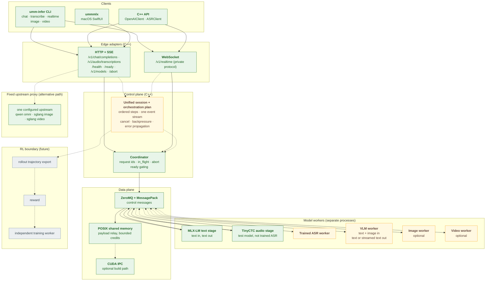

# ummInfer

ummInfer is an inference runtime for **Unified Multimodal Models (UMM)**. The
engine is a C++20 control plane with an OpenAI-compatible HTTP/SSE/WebSocket
surface. Models run in separate worker processes behind ZeroMQ/MessagePack
control messages.

The engine foundation is implemented for text chat and for a deterministic
audio test pipeline. The unified VLM+ASR capability is **not implemented**. The
figure below marks which parts exist.

See [roadmap](docs/roadmap.md) for phases and acceptance gates, and
[validation](docs/validation.md) for the user journeys that exist today.

## Target architecture

Green nodes exist in this revision. Amber nodes are planned. Gray nodes are the
future RL boundary. A dashed edge is an optional or alternative path. The figure
shows the target; the [status table](#status) gives the per-layer state.



Image and video are optional modalities: no local image or video worker exists,
and their only routes are the proxy.

### Current call paths

```text
Local text or audio:
CLI/public API/Swift -> HTTP or WS -> Coordinator -> ZeroMQ
  -> external Python stage (MLX-LM or TinyCTC) -> model -> ZeroMQ -> client

Fixed upstream (no Coordinator use):
CLI/public API -> HTTP -> one configured upstream -> client

C++ stage host (demo):
Coordinator -> ZeroMQ -> C++ Stage -> SimpleScheduler -> echo compute
  -> next C++ Stage through SHM, or CUDA IPC where its requirements hold

The external Python path does not use C++ Stage, SimpleScheduler, or the
shared-memory relay; it carries inline data in ZeroMQ messages.
```

## Status

| Capability | Interface | State |
| --- | --- | --- |
| C++20 control plane: Coordinator, request abort, ready gating | `serve` | Implemented |
| ZeroMQ transport with MessagePack control messages | internal | Implemented |
| POSIX shared-memory payload relay with bounded credits | `stage --next/--peer` | Implemented |
| Optional CUDA IPC relay path | `stage --gpu-id/--peer-gpu` | Build path present; unbuilt and unexecuted here (no CUDA toolkit) |
| External persistent Python stage protocol | `serve --entry-endpoint` | Implemented |
| Text chat, JSON and SSE | `chat`, `/v1/chat/completions` | Implemented on MLX-LM; checked against a real local model |
| File and realtime transcription | `transcribe`, `realtime`, `/v1/audio/transcriptions`, `/v1/realtime` | Implemented against the deterministic TinyCTC test model only |
| Native macOS client | `clients/ummmlx` | Implemented; text chat only |
| Bearer authentication | `serve --api-key` | Implemented |
| Image generation and edit, video jobs | `image`, `video`, `/v1/images/*`, `/v1/videos*` | Fixed upstream proxy only |
| Trained ASR worker | — | Not implemented |
| Real VLM worker | — | Not implemented |
| Cross-model orchestration (for example ASR to VLM) | — | Not implemented |
| Shared session across modalities | — | Not implemented |
| Unified multimodal end-to-end acceptance | — | Not run |
| H20B verification | — | BLOCKED; jump host authentication fails |

TinyCTC has deterministic initialized weights; it is not a speech recognizer.
The MLX-LM chat path is text-only inference, not a VLM. The Mac and H20B
verification profiles and their limits are in
[verification split](docs/roadmap.md#verification-split).

The server exposes `/health`, `/ready`, `/v1/models`, and `/abort`.
`/v1/audio/speech` returns HTTP 501. The opt-in
[fixed upstream mode](#fixed-upstream-proxy-mode) forwards one model family to
one configured upstream; it is a proxy and implements no local VLM or video
model.

## Requirements and limits

- Text models must be MLX-LM models with a compatible text chat template.
- TinyCTC accepts headerless little-endian PCM16, mono, 16 kHz. WAV input must
  contain exactly that format. It accepts 400 samples to 30 seconds of audio.
- Do not pass stereo, compressed audio, another sample rate, or a WAV with
  multiple data chunks. The client rejects unsupported WAV structures.
- Realtime is a private protocol for one aggregated transcription. It is not the
  OpenAI Realtime API. The bundled server sends no partial preview: after the
  stage returns it sends one final `transcription.segment`, then
  `transcription.completed`. Clients can assemble several segments, but this
  server never produces them.
- Chat accepts plain HTTP only on loopback. HTTPS may use a remote host.
- ASR HTTP and HTTPS base URLs, including `--final-url`, are loopback-only.
- Realtime `--url` accepts only loopback `http://` and converts it to `ws://`
  internally. Remote `wss://` is not supported.
- By default, realtime `finish()` sends no `transcription.done`. It closes the
  WebSocket and sends retained PCM through HTTP Final. `--live-result` sends
  `transcription.done` and requests the live completed result. If that result
  fails or exceeds `--final-timeout-ms`, HTTP Final still runs.
- The realtime client retains at most 1 GiB of audio. The bundled WebSocket
  server accumulates at most 64 MiB per session and rejects a larger append.
- Chat supports retries before a stream emits a delta. ASR and realtime do not
  retry inference. Chat supports total, first-token, and stall timeouts. HTTP
  transcription supports total and activity timeouts. Realtime supports setup,
  write, close, and live-result timeouts. Cancellation interrupts transport;
  MLX abort takes effect at token boundaries.
- One external MLX stage processes one request at a time. Other requests queue.
- The C++ stage host contains reference echo compute only. It does not load a
  model.
- On the local path, chat message content must be text. Multimodal content
  arrays, tools, `top_p`, `seed`, non-empty `stop`, usage in `stream_options`,
  and JSON response format are rejected by this server.
- Transcription accepts `model`, `stream`, `max_new_tokens`,
  `include_generation_metadata`, `response_format=json`, and `temperature=0`.
  Other response formats and nonzero temperatures return HTTP 400. `language`,
  `prompt`, `audio_layout`, `stop_at_end_of_text`, and `stop_on_token_loop` are
  explicitly rejected by the current backend.
- The control plane includes decode checks for Python-produced MessagePack
  messages. Map keys must be strings. Integers must fit in signed 64 bits.
- Shared-memory `StagePayload` transfer is supported between C++ stages.
  Python-to-C++ shared-memory payload edges are not supported; external Python
  stages use ZeroMQ messages with inline data.
- CUDA IPC carries host-serialized `StagePayload` bytes. It is not zero-copy
  device-tensor transfer and it does not execute a model. It is selected only
  when both stages declare GPU ids on one host, peer access works in both
  directions, and the packed payload is at most `slot_size_mb` (default 512).
- A receiver rejects a `DataRef` above `max_payload_bytes` (default 1 GiB)
  before any allocation. Pending relay acknowledgements time out after 30
  seconds by default (`transfer_timeout_ms`); a timed-out transfer abandons
  its CUDA edge and other targets keep working.

See [architecture](docs/external_stage.md) and [user validation](docs/validation.md).

## Install and build

Use Zig 0.16.0. On macOS with Homebrew:

```sh
brew install zig libzmq msgpack cpp-httplib nlohmann-json curl libwebsockets
python3 -m venv .venv
.venv/bin/python -m pip install mlx-lm pyzmq msgpack websockets
zig build -Doptimize=ReleaseFast -Ddeps-prefix=/opt/homebrew \
  -Dcurl-prefix=/opt/homebrew/opt/curl
zig build test -Ddeps-prefix=/opt/homebrew -Dcurl-prefix=/opt/homebrew/opt/curl
```

The binary is `zig-out/bin/umm-infer`. Apple's system libcurl 8.7.1 lacks the
WebSocket support required by the realtime client. Use `-Ddeps-prefix` when
dependencies are outside the system include and library paths.

`test` runs wire, relay, scheduler, coordinator, client, fixed-upstream proxy,
and two-stage pipeline tests. It builds and runs no model. On this machine it
exits 0: `all checks passed`, `all transport checks passed`, `all serve proxy
checks passed`, `all 82 client checks passed`.

`smoke` checks HTTP validation, authentication, JSON, SSE, 24 concurrent JSON
requests, 12 concurrent SSE requests, external stages, and SIGTERM shutdown.

The finite request-lifecycle model has a TLA check. It does not prove that the
C++ implementation conforms to the model:

```sh
TLA2TOOLS_JAR=/path/to/tla2tools.jar python3 -I tests/tla_test.py
```

The CPU build is the default. CUDA IPC is an optional build:

```sh
zig build -Dcuda -Dcuda-prefix=/usr/local/cuda -Ddeps-prefix=/opt/homebrew
zig build test -Dcuda -Dcuda-prefix=/usr/local/cuda -Ddeps-prefix=/opt/homebrew
```

`-Dcuda-prefix` must contain `include/` and `lib64/`. `-Dcuda` alone uses the
system include and library paths. With `-Dcuda`, `test` also builds and runs
`cuda_ipc_test` and `cuda_pipeline_test`. Both skip themselves in a CPU build.

Three CUDA-only targets stay out of the default test run:

```sh
# Repeated rounds, stops at the first failure.
zig build cuda-stress -Dcuda -Dcuda-prefix=/usr/local/cuda -Ddeps-prefix=/opt/homebrew

# Two-process latency for SHM and CUDA IPC; ReleaseFast is required.
zig build cuda-bench -Dcuda -Dcuda-prefix=/usr/local/cuda -Ddeps-prefix=/opt/homebrew -Doptimize=ReleaseFast

# compute-sanitizer memcheck over both test binaries.
python3 tests/cuda_sanitize.py --ipc zig-out/bin/cuda_ipc_test \
  --pipeline zig-out/bin/cuda_pipeline_test --log-dir /tmp/cuda-sanitize
```

## Run text generation

Use a local MLX model directory, or a Hugging Face model id. The first use of an
id may download model files. Use separate terminals for the server and stage.

```sh
MODEL=/absolute/path/to/mlx-model
IPC_DIR=$(mktemp -d /tmp/umminfer-mlx.XXXXXX)

./zig-out/bin/umm-infer serve --host 127.0.0.1 --port 30000 \
  --model "$MODEL" --entry mlx --entry-endpoint "ipc://$IPC_DIR/entry" \
  --completion "ipc://$IPC_DIR/completion" --abort "ipc://$IPC_DIR/abort"
```

```sh
.venv/bin/python -I python/umminfer_mlx_stage.py \
  --name mlx --recv "ipc://$IPC_DIR/entry" \
  --coordinator "ipc://$IPC_DIR/completion" --abort "ipc://$IPC_DIR/abort" \
  --model "$MODEL"
```

The server queues requests until the stage announces readiness.

```sh
./zig-out/bin/umm-infer chat --url http://127.0.0.1:30000/v1 \
  --model "$MODEL" --prompt 'Give one inference tip.' \
  --max-tokens 64 --temperature 0

./zig-out/bin/umm-infer chat --url http://127.0.0.1:30000/v1 \
  --model "$MODEL" --prompt 'Count to three.' --stream --max-tokens 64
```

The client reads `OPENAI_BASE_URL` and `OPENAI_MODEL` when the corresponding
options are absent. With no `--prompt`, it reads the prompt from standard input.

### Measured stage result

The frozen comparison baseline already caches the tokenizer vocabulary map. The
current stage adds a reusable prompt KV snapshot with a reused detokenizer, and
one fused quantized QKV projection per layer instead of three. The fusion
applies to quantized Qwen2-architecture models whose Q, K, and V projections
share one quantization layout; on another layout it is skipped.

The recorded result for the current stage against that baseline is a **61.93%
warm speedup on median total latency**: warm median `total_ms` fell from
63.75343748368323 ms to 39.37083296477795 ms. Using the unrounded sample
medians, the speedup is `(baseline / candidate - 1) * 100` = 61.93%, and the
same change is `(1 - candidate / baseline) * 100` = 38.25% fewer milliseconds.
Computing either value from the two-decimal display figures gives a rounding
artifact, not the measured result. Configuration: `http_sse`, `max_tokens=64`,
20 interleaved pairs, fresh process per sample, 2 warmups per process,
`temperature=0`, Qwen2.5-0.5B-Instruct-4bit.

The fused QKV step alone is smaller: 3.92% in the direct in-process harness
(391.05 to 406.39 output tokens per second) on the arm that already had the
vocabulary cache and prompt KV. Do not attribute the 61.93% to the fusion.

Conditions that limit the claim:

- It is a ratio of medians, not a median of per-pair ratios. The median
  per-pair speedup is 51.11%, and 2 of the 20 pairs were slower with the
  candidate arm.
- Every recorded `cv` is above the 0.10 quiet-window limit: warm `total_ms`
  0.167 baseline and 0.287 candidate; warm `ttft_ms` 0.328 and 2.735. The run
  printed four `cv` warnings. By the project rule this is one recorded run that
  asks for a repeat, not a validated result.
- Output hashes matched across arms on all 20 pairs, and a second script
  recomputed the stored medians and matched.
- The token counters are absent, not estimated. The frozen binary's chat reply
  carries no `usage`, `generation_tokens`, or `prompt_tokens`, and peak memory
  is unobservable without `--perf-log`. The report records those gaps.
- The report did not pass the `tests/mlx_perf_compare.py` gate set; it has a
  recompute check only.
- Both the HTTP A/B harness and its report are local artifacts outside this
  repository, so the number cannot be re-derived from a clean checkout alone.
- The in-repository harnesses for the same stage are
  `tests/mlx_prompt_cache_perf.py` (direct MLX-LM A/B) and `tests/mlx_perf.py`
  (general comparison). Their gates are in [MLX backend](docs/mlx.md).

## Run the audio test pipeline

Generate a new TinyCTC model directory, then use separate terminals:

```sh
ASR_MODEL=$(mktemp -d /tmp/umminfer-tiny-model.XXXXXX)/model
.venv/bin/python -I python/umminfer_tiny_asr_stage.py generate --output "$ASR_MODEL"
ASR_IPC=$(mktemp -d /tmp/umminfer-asr.XXXXXX)

./zig-out/bin/umm-infer serve --host 127.0.0.1 --port 31000 \
  --realtime-port 31001 --model tiny-ctc --entry asr \
  --entry-endpoint "ipc://$ASR_IPC/entry" \
  --completion "ipc://$ASR_IPC/completion" --abort "ipc://$ASR_IPC/abort"
```

```sh
.venv/bin/python -I python/umminfer_tiny_asr_stage.py serve \
  --name asr --recv "ipc://$ASR_IPC/entry" \
  --coordinator "ipc://$ASR_IPC/completion" --abort "ipc://$ASR_IPC/abort" \
  --model "$ASR_MODEL"
```

Use an existing 16 kHz mono PCM16 WAV file. Port 31001 carries the WebSocket
session. `--final-url` sends the default or fallback HTTP Final to port 31000.

```sh
./zig-out/bin/umm-infer transcribe --url http://127.0.0.1:31000 \
  --model tiny-ctc --file audio.wav --max-new-tokens 64

./zig-out/bin/umm-infer realtime --url http://127.0.0.1:31001 --final-url http://127.0.0.1:31000 \
  --model tiny-ctc --file audio.wav --max-new-tokens 64

# Accept the live result, with HTTP Final retained as fallback.
./zig-out/bin/umm-infer realtime --url http://127.0.0.1:31001 --final-url http://127.0.0.1:31000 \
  --model tiny-ctc --file audio.wav --live-result --final-timeout-ms 20000
```

For raw PCM, pass `--format pcm`. A file ending in `.wav` is decoded as WAV;
other file names default to raw PCM. `--file -` reads bytes from standard input.

## In-process demo and C++ stages

The demo runs the echo compute path without an external stage:

```sh
./zig-out/bin/umm-infer serve --demo --port 30000 --ipc-dir /tmp/omni-demo

curl -s localhost:30000/v1/chat/completions \
  -H 'Content-Type: application/json' \
  -d '{"model":"omni","messages":[{"role":"user","content":"hi"}]}'
```

A coordinator and two external C++ stages run in separate terminals:

```sh
./zig-out/bin/umm-infer serve --port 30000 --entry entry \
  --entry-endpoint ipc:///tmp/omni/entry \
  --completion ipc:///tmp/omni/completion --abort ipc:///tmp/omni/abort

./zig-out/bin/umm-infer stage --name entry --recv ipc:///tmp/omni/entry \
  --coordinator ipc:///tmp/omni/completion --abort ipc:///tmp/omni/abort \
  --next worker=ipc:///tmp/omni/worker

./zig-out/bin/umm-infer stage --name worker --recv ipc:///tmp/omni/worker \
  --coordinator ipc:///tmp/omni/completion --abort ipc:///tmp/omni/abort \
  --peer entry=ipc:///tmp/omni/entry
```

The downstream `--peer entry=...` endpoint carries relay acknowledgements to
the upstream stage. Without it, upstream transfer credits are not released.
ZMQ does not create the parent directory of an `ipc://` path; the launchers
create it and remove stale socket files for configured endpoints.

### CUDA IPC stages

Two stages on one host can move payloads through CUDA IPC. Declare each stage's
device, and give the sender the device of the stage it sends to:

```sh
./zig-out/bin/umm-infer stage --name entry --gpu-id 0 \
  --recv ipc:///tmp/omni/entry --coordinator ipc:///tmp/omni/completion \
  --abort ipc:///tmp/omni/abort --next worker=ipc:///tmp/omni/worker \
  --peer worker=ipc:///tmp/omni/worker --peer-gpu worker=1

./zig-out/bin/umm-infer stage --name worker --gpu-id 1 \
  --recv ipc:///tmp/omni/worker --coordinator ipc:///tmp/omni/completion \
  --abort ipc:///tmp/omni/abort --peer entry=ipc:///tmp/omni/entry
```

- `--gpu-id N` gives the stage its CUDA device.
- `--peer-gpu name=N` gives the device of a peer stage on the same host.
- The sender checks peer access in both directions before selecting CUDA IPC.
- Two stages on the same device use CUDA IPC without peer access.
- If peer access is unavailable, the payload exceeds the slot limit, or
  `UMMINFER_DISABLE_CUDA_IPC=1` is set, the edge uses POSIX shared memory.
  The fallback is logged once per edge.

None of these commands has been executed on this machine, which has no CUDA
toolkit: `zig build -Dcuda` stops here when `cuda_runtime_api.h` is not found.
The relay code has default-test coverage only.

## Fixed upstream proxy mode

`serve` can forward requests to one external model server instead of running a
local stage. This mode is separate from the engine foundation. It adds no local
model, no local orchestration, and no local session.

```sh
# Official compatible API, omni variant.
./zig-out/bin/umm-infer serve --port 30000 --model MY-MODEL \
  --upstream-kind qwen --upstream-base-url https://example.invalid/v1 \
  --upstream-model MODEL-ID --upstream-variant omni

# SGLang server, image or video variant.
./zig-out/bin/umm-infer serve --port 30000 --model MY-MODEL \
  --upstream-kind sglang --upstream-base-url http://127.0.0.1:30010 \
  --upstream-model MODEL-ID --upstream-variant image
```

Rules of this mode:

- One process serves one upstream, one model, and one variant. There is no
  routing or fallback between upstreams.
- The route set follows the variant. `qwen` serves only
  `POST /v1/chat/completions`. `sglang` with `image` serves
  `POST /v1/images/generations` and `POST /v1/images/edits`. `sglang` with
  `video` serves `POST /v1/videos`, `GET /v1/videos/{id}`,
  `GET /v1/videos/{id}/content`, and `DELETE /v1/videos/{id}`.
- Every other media route answers HTTP 501. A server with no upstream flags also
  answers 501 on all image and video routes.
- The upstream credential comes from `--upstream-api-key` or
  `UMMINFER_UPSTREAM_API_KEY`. It is sent only to the upstream. It must differ
  from `--api-key`.
- The request body's `model` field is replaced with `--upstream-model` before
  forwarding.
- `/abort` answers HTTP 501. A fixed upstream is not a coordinator job.
- Remote plain HTTP is rejected. A plain-HTTP upstream must be loopback.
- Requests bypass the Coordinator submission path, C++ `Stage`, and the relay.
  The process still constructs a Coordinator, but no proxy request uses it.
- `/ready` answers 200 immediately when no entry stage is configured.

The CLI multimodal flags need this mode. `chat --image-url`, `--video-url`,
`--audio`, and `--audio-out` send content parts that the local MLX path rejects;
they work only against an `omni` upstream. `image generate`, `image edit`, and
the `video` subcommands need an `image` or `video` upstream.

The default test suite checks configuration validation, route gating, error
mapping, and credential scrubbing against a real local server with an
unreachable upstream. It does not prove an upstream success. Live scripts
`tests/qwen_omni_live.py`, `tests/h3_live.py`, and `tests/h3_image_live.py`
require `UMMINFER_LIVE_OPT_IN=1` and provider credentials. Without them they
print `BLOCKED`/`NOT_COVERED` and make no network request. No live upstream run
is recorded for this revision.

## Authentication

The server enables authentication with `serve --api-key KEY`. It protects HTTP,
health, readiness, and WebSocket upgrade requests. Start it on a private
interface. The server key option can be visible in the local process list.

Do not put client keys in command-line arguments. The client reads
`UMMINFER_API_KEY`, then `OPENAI_API_KEY`:

```sh
export UMMINFER_API_KEY='your-key'
./zig-out/bin/umm-infer transcribe --url http://127.0.0.1:31000 \
  --model tiny-ctc --file audio.wav
./zig-out/bin/umm-infer realtime --url http://127.0.0.1:31001 --final-url http://127.0.0.1:31000 \
  --model tiny-ctc --file audio.wav
```

Realtime WebSocket and its HTTP Final use the same client key.

## C++ API

Include `umminfer/client/client.hpp`. `OpenAIClient::chat` provides JSON and SSE
chat. `ASRClient::transcribe` converts PCM to WAV and uploads it as a multipart
`file` part; it always sets `stream=true` and parses the SSE reply.
`ASRClient::realtime` creates a session with `send`, `finish`, and `close`.
Requests accept cancellation flags.

`umminfer/audio/audio.hpp` provides `wav_from_pcm16` and `pcm16_from_wav`.
The client namespace retains thin wrappers that convert invalid audio errors to
`ErrorCode::kBadRequest`.

## Desktop client

`clients/ummmlx` is a native macOS SwiftUI client for a local MLX server. It
supports incremental SSE chat, Stop, New chat, and light/dark appearance. It
covers text chat only; voice, ASR, image, and video are `NOT_COVERED` there. See
[clients/ummmlx/README.md](clients/ummmlx/README.md).

## Layout

```text
build.zig
include/umminfer/{audio,client,proto,relay,comm,scheduling,pipeline,serve}
src/{audio,client,proto,relay,comm,scheduling,pipeline,serve}
src/main.cpp
python/{umminfer_mlx_stage.py,umminfer_tiny_asr_stage.py}
clients/ummmlx/
tests/self_check.cpp
tests/compat/{wire_compat.cpp,runtime_compat.cpp}
tests/{cuda_ipc_test.cpp,cuda_pipeline_test.cpp,cuda_bench.cpp}
tests/{omni_client_test.cpp,omni_serve_test.cpp,omni_transport_test.cpp}
tests/{cuda_stress.py,cuda_sanitize.py,http_smoke.py,tla_test.py}
tests/{client_smoke.py,client_retry_e2e.py,client_boundary_e2e.py}
tests/{realtime_contract_e2e.py,realtime_client_contract_e2e.py}
tests/{mlx_smoke.py,mlx_stage_test.py,mlx_*_perf.py,client_benchmark.py}
tests/{qwen_omni_live.py,h3_live.py,h3_image_live.py,live_common.py}
tests/tla/{RequestLifecycle.tla,RequestLifecycle.cfg}
docs/{cuda-ipc.md,external_stage.md,mlx.md,client.md,roadmap.md,validation.md}
```
