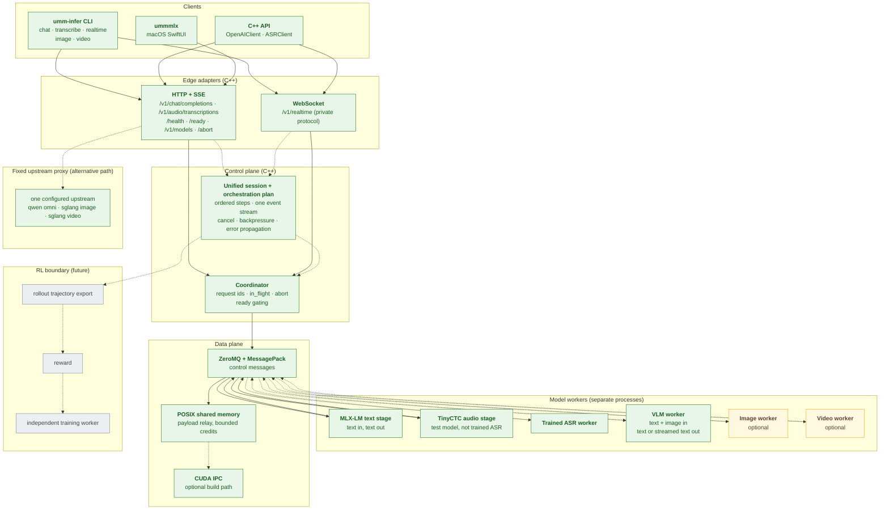

# ummInfer

ummInfer is an inference runtime for **Unified Multimodal Models (UMM)**. The
engine is a C++20 control plane with an OpenAI-compatible HTTP/SSE/WebSocket
surface. Models run in separate worker processes behind ZeroMQ/MessagePack
control messages.

The engine foundation is implemented for text chat, a deterministic audio test
pipeline, and public ASR -> VLM orchestration. `umminfer::UnifiedEngine` reuses
the same `Coordinator`, external workers, and HTTP/SSE chat contract. The
[status table](#status) separates the real H20B audio-only run from unrun gates.

See [roadmap](docs/roadmap.md) for phases and acceptance gates, and
[validation](docs/validation.md) for the user journeys that exist today.

## Target architecture

Green means the code for that node is present in this revision; it does not mean
a run was recorded. Amber nodes are planned. Gray nodes are the future RL
boundary. A dashed edge is an optional or alternative path. The figure shows the
target; the [status table](#status) gives the per-layer state, including the
CUDA path, whose code is present but which is unbuilt and unexecuted here.



Image and video are optional modalities: no local image or video worker exists.
Image input reaches the VLM leg of unified mode unchanged; video has no route
outside the proxy.

### Current call paths

```text
Local text or audio:
CLI/public API/Swift -> HTTP or WS -> Coordinator -> ZeroMQ
  -> external Python stage (MLX-LM or TinyCTC) -> model -> ZeroMQ -> client

Unified audio:
CLI/public HTTP -> OpenAIApi -> UnifiedEngine -> Coordinator -> ZeroMQ
  -> Qwen ASR -> final transcript -> Qwen Omni -> HTTP/SSE

Fixed upstream (no Coordinator use):
CLI/public API -> HTTP -> one configured upstream -> client

C++ stage host (demo):
Coordinator -> ZeroMQ -> C++ Stage -> SimpleScheduler -> echo compute
  -> next C++ Stage through SHM, or CUDA IPC where its requirements hold

The external Python path does not use C++ Stage, SimpleScheduler, or the
shared-memory relay; it carries inline data in ZeroMQ messages.
```

## Status

| Capability | Interface | State |
| --- | --- | --- |
| C++20 control plane: Coordinator, request abort, ready gating | `serve` | Implemented |
| ZeroMQ transport with MessagePack control messages | internal | Implemented |
| POSIX shared-memory payload relay with bounded credits | `stage --next/--peer` | Implemented |
| Optional CUDA IPC relay path | `stage --gpu-id/--peer-gpu` | Built and executed on H20B 2026-11-14: build, IPC tests, compute-sanitizer, and 10/10 stress rounds passed on dedicated GPUs 2 and 3 |
| External persistent Python stage protocol | `serve --entry-endpoint` | Implemented |
| Text chat, JSON and SSE | `chat`, `/v1/chat/completions` | Implemented on MLX-LM; checked against a real local model with no run artifact committed |
| File and realtime transcription | `transcribe`, `realtime`, `/v1/audio/transcriptions`, `/v1/realtime` | Implemented against the deterministic TinyCTC test model only |
| Native macOS client | `clients/ummmlx` | Implemented; text chat only |
| Bearer authentication | `serve --api-key` | Implemented |
| Image generation and edit, video jobs | `image`, `video`, `/v1/images/*`, `/v1/videos*` | Fixed upstream proxy only |
| Trained ASR worker | `umminfer_qwen_asr_stage.py` | Real `qwen3-asr` transcription verified on H20B |
| Incremental ASR streaming and realtime partials | `stream=true` stage request, `/v1/realtime` | Verified on real `qwen3-asr` on H20B: 7 cumulative partials then one final; audio is buffered until `transcription.done` |
| GPU-side abort confirmation, both legs | stage abort -> SGLang `/abort_request` with the request `rid` | Verified on H20B: ASR and VLM/Omni streams each ended with `finish_reason=abort`; evidence in `/tmp/umminfer-phase5-streaming-abort-evidence/` |
| WebSocket control-frame interleaving | `realtime --ping-interval-ms` | Verified with real client PING/PONG frames during a continuous stream |
| Real VLM worker | `umminfer_qwen_omni_worker.py` | Real `qwen3-omni` streamed text and image input verified on H20B |
| Cross-model orchestration | `UnifiedEngine`, `serve --vlm-entry-endpoint` | Public HTTP/SSE and real CLI ASR -> VLM verified on H20B |
| Shared session across modalities | `session_id` on `/v1/chat/completions` | Implemented as a grouping label; sequential, concurrent, error, and cancel cases verified on H20B |
| Optional multi-turn session history | `serve --session-history`, request `session_history=true` | Real H20B two-turn, cancel/error exclusion, and default-off validation passed 2026-11-14; evidence in `/tmp/umminfer-phase5-final-h20b-evidence/live/` |
| Unified multimodal end-to-end acceptance | `chat --audio`, `/v1/chat/completions` | Real joint image+audio, same-session reuse, cancel, failure, and recovery verified on H20B; full Phase 2/3 gates `NOT_COVERED` |
| H20B verification | Two SGLang workers | Accessible; Qwen ASR GPU 1 and Qwen Omni GPU 0 verified; CUDA build, IPC, sanitizer, and stress verified 2026-11-14 on GPUs 2 and 3 |
| Real RL optimizer-step validation | `umminfer_rl_*.py` | Real Qwen2.5-0.5B rollouts on GSM8K, verifiable exact-match reward, separate-worker REINFORCE AdamW steps, non-zero gradients and weight deltas, two hash-chained checkpoints; architecture validation only, not business training; see [rl-phase2](docs/rl-phase2.md) |

TinyCTC has deterministic initialized weights; it is not a speech recognizer.
The MLX-LM chat path is text-only inference, not a VLM. The Mac and H20B
verification profiles and their limits are in
[verification split](docs/roadmap.md#verification-split).

The server exposes `/health`, `/ready`, `/v1/models`, and `/abort`.
`/v1/audio/speech` returns HTTP 501. The opt-in
[fixed upstream mode](#fixed-upstream-proxy-mode) forwards one model family to
one configured upstream; it is a proxy and implements no local VLM or video
model.

## Requirements and limits

- Text models must be MLX-LM models with a compatible text chat template.
- TinyCTC accepts headerless little-endian PCM16, mono, 16 kHz. WAV input must
  contain exactly that format. It accepts 400 samples to 30 seconds of audio.
- Do not pass stereo, compressed audio, another sample rate, or a WAV with
  multiple data chunks. The client rejects unsupported WAV structures.
- Realtime is a private protocol for one aggregated transcription. It is not the
  OpenAI Realtime API. The bundled server sends no partial preview: after the
  stage returns it sends one final `transcription.segment`, then
  `transcription.completed`. Clients can assemble several segments, but this
  server never produces them.
- Chat accepts plain HTTP only on loopback. HTTPS may use a remote host.
- ASR HTTP and HTTPS base URLs, including `--final-url`, are loopback-only.
- Realtime `--url` accepts only loopback `http://` and converts it to `ws://`
  internally. Remote `wss://` is not supported.
- By default, realtime `finish()` sends no `transcription.done`. It closes the
  WebSocket and sends retained PCM through HTTP Final. `--live-result` sends
  `transcription.done` and requests the live completed result. If that result
  fails or exceeds `--final-timeout-ms`, HTTP Final still runs.
- The realtime client retains at most 1 GiB of audio. The bundled WebSocket
  server accumulates at most 64 MiB per session and rejects a larger append.
- Chat supports retries before a stream emits a delta. ASR and realtime do not
  retry inference. Chat supports total, first-token, and stall timeouts. HTTP
  transcription supports total and activity timeouts. Realtime supports setup,
  write, close, and live-result timeouts. `--ping-interval-ms N` sends WebSocket
  PING control frames during the session; the server answers with PONG.
  Cancellation interrupts transport; MLX abort takes effect at token boundaries.
  The Qwen ASR stage additionally sends SGLang `/abort_request` and reports the
  backend's `finish_reason=abort` acknowledgement.
- One external MLX stage processes one request at a time. Other requests queue.
- The C++ stage host contains reference echo compute only. It does not load a
  model.
- On the local path, chat message content must be text. Multimodal content
  arrays, tools, `top_p`, `seed`, non-empty `stop`, usage in `stream_options`,
  and JSON response format are rejected by this server.
- Transcription accepts `model`, `stream`, `max_new_tokens`,
  `include_generation_metadata`, `response_format=json`, and `temperature=0`.
  Other response formats and nonzero temperatures return HTTP 400. `language`,
  `prompt`, `audio_layout`, `stop_at_end_of_text`, and `stop_on_token_loop` are
  explicitly rejected by the current backend.
- The control plane includes decode checks for Python-produced MessagePack
  messages. Map keys must be strings. Integers must fit in signed 64 bits.
- Shared-memory `StagePayload` transfer is supported between C++ stages.
  Python-to-C++ shared-memory payload edges are not supported; external Python
  stages use ZeroMQ messages with inline data.
- CUDA IPC carries host-serialized `StagePayload` bytes. It is not zero-copy
  device-tensor transfer and it does not execute a model. It is selected only
  when both stages declare GPU ids on one host, peer access works in both
  directions, and the packed payload is at most `slot_size_mb` (default 512).
- A receiver rejects a `DataRef` above `max_payload_bytes` (default 1 GiB)
  before any allocation. Pending relay acknowledgements time out after 30
  seconds by default (`transfer_timeout_ms`); a timed-out transfer abandons
  its CUDA edge and other targets keep working.

See [architecture](docs/external_stage.md) and [user validation](docs/validation.md).

## Install and build

Use Zig 0.16.0. On macOS with Homebrew:

```sh
brew install zig libzmq msgpack cpp-httplib nlohmann-json curl libwebsockets
python3 -m venv .venv
.venv/bin/python -m pip install mlx-lm pyzmq msgpack websockets
zig build -Doptimize=ReleaseFast -Ddeps-prefix=/opt/homebrew \
  -Dcurl-prefix=/opt/homebrew/opt/curl
zig build test -Ddeps-prefix=/opt/homebrew -Dcurl-prefix=/opt/homebrew/opt/curl
```

The binary is `zig-out/bin/umm-infer`. Apple's system libcurl 8.7.1 lacks the
WebSocket support required by the realtime client. Use `-Ddeps-prefix` when
dependencies are outside the system include and library paths.

`test` runs six C++ executables: wire, relay, scheduler, coordinator, client, and
fixed-upstream proxy, plus the two-stage pipeline cases. It builds and runs no
model, no Python, and no Swift. It needs the dependency flags shown above; a bare
`zig build test` fails to find `msgpack.h` and `zmq.h`. On this machine, with the
flags, it exits 0: `all checks passed`, `all transport checks passed`, `all serve
proxy checks passed`, `all 82 client checks passed`.

`smoke` checks HTTP validation, authentication, JSON, SSE, 24 concurrent JSON
requests, 12 concurrent SSE requests, external stages, and SIGTERM shutdown.

The Python E2E and performance scripts under `tests/` are not wired into any
`zig build` step. Run them by hand as the sections below show. The Swift client
has its own suite, `swift test` in `clients/ummmlx`.

The finite request-lifecycle model has a TLA check. It does not prove that the
C++ implementation conforms to the model:

```sh
TLA2TOOLS_JAR=/path/to/tla2tools.jar python3 -I tests/tla_test.py
```

The CPU build is the default. CUDA IPC is an optional build:

```sh
zig build -Dcuda -Dcuda-prefix=/usr/local/cuda -Ddeps-prefix=/opt/homebrew
zig build test -Dcuda -Dcuda-prefix=/usr/local/cuda -Ddeps-prefix=/opt/homebrew
```

`-Dcuda-prefix` must contain `include/` and `lib64/`. `-Dcuda` alone uses the
system include and library paths. With `-Dcuda`, `test` also builds and runs
`cuda_ipc_test` and `cuda_pipeline_test`. Both skip themselves in a CPU build.

Three CUDA-only targets stay out of the default test run:

```sh
# Repeated rounds, stops at the first failure.
zig build cuda-stress -Dcuda -Dcuda-prefix=/usr/local/cuda -Ddeps-prefix=/opt/homebrew

# Two-process latency for SHM and CUDA IPC; ReleaseFast is required.
zig build cuda-bench -Dcuda -Dcuda-prefix=/usr/local/cuda -Ddeps-prefix=/opt/homebrew -Doptimize=ReleaseFast

# compute-sanitizer memcheck over both test binaries.
python3 tests/cuda_sanitize.py --ipc zig-out/bin/cuda_ipc_test \
  --pipeline zig-out/bin/cuda_pipeline_test --log-dir /tmp/cuda-sanitize
```

## Run text generation

Use a local MLX model directory, or a Hugging Face model id. The first use of an
id may download model files. Use separate terminals for the server and stage.

```sh
MODEL=/absolute/path/to/mlx-model
IPC_DIR=$(mktemp -d /tmp/umminfer-mlx.XXXXXX)

./zig-out/bin/umm-infer serve --host 127.0.0.1 --port 30000 \
  --model "$MODEL" --entry mlx --entry-endpoint "ipc://$IPC_DIR/entry" \
  --completion "ipc://$IPC_DIR/completion" --abort "ipc://$IPC_DIR/abort"
```

```sh
.venv/bin/python -I python/umminfer_mlx_stage.py \
  --name mlx --recv "ipc://$IPC_DIR/entry" \
  --coordinator "ipc://$IPC_DIR/completion" --abort "ipc://$IPC_DIR/abort" \
  --model "$MODEL"
```

The server queues requests until the stage announces readiness.

```sh
./zig-out/bin/umm-infer chat --url http://127.0.0.1:30000/v1 \
  --model "$MODEL" --prompt 'Give one inference tip.' \
  --max-tokens 64 --temperature 0

./zig-out/bin/umm-infer chat --url http://127.0.0.1:30000/v1 \
  --model "$MODEL" --prompt 'Count to three.' --stream --max-tokens 64
```

The client reads `OPENAI_BASE_URL` and `OPENAI_MODEL` when the corresponding
options are absent. With no `--prompt`, it reads the prompt from standard input.

### Measured stage result

The frozen comparison baseline already caches the tokenizer vocabulary map. The
current stage adds a reusable prompt KV snapshot with a reused detokenizer, and
one fused quantized QKV projection per layer instead of three. The fusion
applies to quantized Qwen2-architecture models whose Q, K, and V projections
share one quantization layout; on another layout it is skipped.

The recorded result for the current stage against that baseline is a **61.93%
warm speedup on median total latency**: warm median `total_ms` fell from
63.75343748368323 ms to 39.37083296477795 ms. Using the unrounded sample
medians, the speedup is `(baseline / candidate - 1) * 100` = 61.93%, and the
same change is `(1 - candidate / baseline) * 100` = 38.25% fewer milliseconds.
Computing either value from the two-decimal display figures gives a rounding
artifact, not the measured result. Configuration: `http_sse`, `max_tokens=64`,
20 interleaved pairs, fresh process per sample, 2 warmups per process,
`temperature=0`, Qwen2.5-0.5B-Instruct-4bit.

The fused QKV step alone is smaller: 3.92% in the direct in-process harness
(391.05 to 406.39 output tokens per second) on the arm that already had the
vocabulary cache and prompt KV. Do not attribute the 61.93% to the fusion.

Conditions that limit the claim:

- It is a ratio of medians, not a median of per-pair ratios. The median
  per-pair speedup is 51.11%, and 2 of the 20 pairs were slower with the
  candidate arm.
- Every recorded `cv` is above the 0.10 quiet-window limit: warm `total_ms`
  0.167 baseline and 0.287 candidate; warm `ttft_ms` 0.328 and 2.735. The run
  printed four `cv` warnings. By the project rule this is one recorded run that
  asks for a repeat, not a validated result.
- Output hashes matched across arms on all 20 pairs, and a second script
  recomputed the stored medians and matched.
- The token counters are absent, not estimated. The frozen binary's chat reply
  carries no `usage`, `generation_tokens`, or `prompt_tokens`, and peak memory
  is unobservable without `--perf-log`. The report records those gaps.
- The report did not pass the `tests/mlx_perf_compare.py` gate set; it has a
  recompute check only.
- Both the HTTP A/B harness and its report are local artifacts outside this
  repository, so the number cannot be re-derived from a clean checkout alone.
- The in-repository harnesses for the same stage are
  `tests/mlx_prompt_cache_perf.py` (direct MLX-LM A/B) and `tests/mlx_perf.py`
  (general comparison). Their gates are in [MLX backend](docs/mlx.md).

The real H20B unified performance baseline is in
[Unified performance baseline](docs/performance-baseline.md): 10 scenario
blocks, 200 successful requests, and unified concurrency 1/2/4. One Omni worker
delivers about 20 output tokens/s; higher concurrency queues behind it.

## Run real Qwen ASR -> VLM

`serve --vlm-entry-endpoint` connects the existing public chat route to
`UnifiedEngine`. The same `Coordinator` submits the ASR leg and then the VLM
leg. There is no second engine or transport protocol. The two SGLang backends
must already serve `qwen3-asr` and `qwen3-omni` on the configured loopback URLs.

```sh
IPC=$(mktemp -d /tmp/umminfer-qwen-unified.XXXXXX)

python3 -I python/umminfer_qwen_asr_stage.py serve \
  --name asr --recv "ipc://$IPC/asr" \
  --coordinator "ipc://$IPC/done" --abort "ipc://$IPC/abort" \
  --model qwen3-asr --backend-url http://127.0.0.1:43100

python3 -I python/umminfer_qwen_omni_worker.py \
  --name vlm --recv "ipc://$IPC/vlm" \
  --coordinator "ipc://$IPC/done" --abort "ipc://$IPC/abort" \
  --upstream-base-url http://127.0.0.1:43101/v1 \
  --upstream-model qwen3-omni

./zig-out/bin/umm-infer serve --host 127.0.0.1 --port 43200 \
  --model qwen3-unified --entry asr --entry-endpoint "ipc://$IPC/asr" \
  --vlm-entry vlm --vlm-entry-endpoint "ipc://$IPC/vlm" \
  --completion "ipc://$IPC/done" --abort "ipc://$IPC/abort"

./zig-out/bin/umm-infer chat --url http://127.0.0.1:43200/v1 \
  --model qwen3-unified --audio speech.wav --prompt '' \
  --stream --max-tokens 128 --temperature 0
```

The public request accepts exactly one WAV `input_audio` part, at most one
`image_url` part, and at most one `text` part. Video parts are rejected. WAV must
be PCM16, mono, 16 kHz. The `text` part is an optional client instruction, for
example "describe this image". ASR runs as one non-streaming request and receives
PCM only; it never sees the image or the instruction. The VLM receives the
instruction, the original `image_url` part, and the final transcript as the last
`text` part. It keeps the public sampling and streaming parameters.

`image_url.url` may be a `data:` URL or a remote `http(s)` URL. The engine does
not fetch it: it forwards the URL unchanged to the VLM worker, and the SGLang
backend fetches the bytes. On H20B 2026-11-14 a local HTTP server served
`man_ironing.png`; the worker log held that URL, the server recorded the GET
with the input SHA256, and the answer described the man ironing a blue garment
while the same request without the image answered that no image was present.

The optional top-level `session_id` is a nonempty string of at most 128
characters. It is a grouping label, not conversation history:

- every event of every request carrying it reports the same `session_id`;
- each request keeps its own `request_id`, its own gap-free `seq` from 0, and
  its own terminal event;
- requests in one session may run one after another or concurrently;
- no transcript, answer, or message history crosses between requests.

There is no multi-turn context in this mode by default. A client that needs
history without the opt-in must send it as its own state. A server without a
unified engine rejects a non-null `session_id` with HTTP 400
`session_id requires unified mode`; it is never accepted and dropped.

### Optional multi-turn session history

History is off by default and has two opt-in gates. The server process starts
with the `--session-history` switch, and a request then sets the top-level
boolean `session_history` together with a nonempty `session_id`:

```json
{"session_id": "conv-1", "session_history": true, "messages": [...]}
```

Rules and limits:

- default behavior is unchanged: without the switch, or without
  `session_history=true`, `session_id` stays a grouping label and no history
  crosses requests;
- a non-unified server rejects `session_history` with HTTP 400
  `session_history requires unified mode`; a unified server started without the
  switch rejects it with HTTP 400 `session_history is not enabled on this
  server`; a missing `session_id` is rejected with HTTP 400
  `session_history requires a nonempty session_id`;
- only a request that reaches a successful `complete` terminal enters history;
  cancelled and failed requests leave no turn, so failed output never becomes
  context;
- each stored turn is the final ASR transcript (user) and the aggregated VLM
  answer (assistant), prepended to the next VLM prompt as plain-text
  user/assistant messages ahead of the current user turn;
- the store is process-local memory inside `UnifiedEngine`, guarded by the
  engine mutex. It holds at most 8 turns and 16384 characters per session and
  at most 256 sessions; the oldest turn or least recently used session is
  evicted first, and an oversized single turn evicts itself. There is no
  database and no persistence: engine destruction or process restart drops
  every turn;
- every request keeps its own request id, its own gap-free `seq` from 0, and
  its own terminal. Concurrent requests in one session never observe each
  other's uncommitted turns.

Real H20B multi-turn validation passed on 2026-11-14. Two sequential requests
in one session with `session_history=true` produced a second `:vlm` prompt that
held the first transcript as a prior `user` message and the first answer as a
prior `assistant` message. Both requests kept distinct request ids, their own
gap-free `seq` from 0, and one terminal each. A cancelled turn and a failed
turn left no entry: the next prompt contained neither transcript. A request
without `session_history` on the same server carried no prior turn, and a
server started without `--session-history` rejected the opt-in with HTTP 400.
Evidence is in `/tmp/umminfer-phase5-final-h20b-evidence/live/`
(`tests/unified_remote_image_history_live.py`). Local deterministic contract
coverage is in `tests/unified_contract_test.cpp` (`test_session_history_*`,
`test_public_http_session_history`).

SSE remains `chat.completion.chunk`. A chunk can carry a `unified` object with
`kind`, `stage`, `seq`, `session_id`, `is_final`, and `text`. Assistant `content`
contains VLM output only; the ASR transcript is in the `asr_final` metadata.
`/ready` requires both workers. `/abort` cancels the unified request, and
`/health.in_flight` reports unified requests in this mode.

ASR increment output is opt-in per request. Send
`"stream_options": {"include_asr_partials": true}` with `"stream": true` in
unified mode. The ASR leg then requests SGLang streaming, and the event order is
`asr_partial` (deltas, `is_final=false`) -> one `asr_final` (the complete
transcript, which replaces the partials) -> `vlm_delta` -> one terminal. `seq`
stays gap-free from 0. Without the field the ASR leg still submits
`stream=false`, so the default stream is exactly one `asr_final`, then VLM
deltas, then one terminal. A server without a unified engine rejects the field
with HTTP 400 `stream_options.include_asr_partials requires unified mode`.
`include_usage` remains unsupported.

A cancel during the VLM leg reaches the GPU scheduler. The Omni worker registers
a per-process-unique `rid` with `/v1/chat/completions` and, on cancel, posts that
rid to SGLang `/abort_request`. SGLang confirms on the generate stream with
`finish_reason: "abort"`; the worker records
`SGLANG_ABORT_CONFIRMED rid=... finish=abort` after the abort POST returns 200.
A local socket close is not treated as confirmation. The public stream still
ends with exactly one `cancelled` terminal.

Both Qwen workers accept `--concurrency N`, where 1 is the serial default and N
runs up to N upstream requests in parallel so the SGLang backend can batch
them. The H20B A/B used 4; see
[Joint worker concurrency optimization](docs/joint-optimization.md).

The Qwen Omni worker's optional `--log-requests` records the messages it actually
received. Its optional `--perf-log` writes JSON-lines queue, request-start, abort
and completion records. Both are intended for validation and are off by default.

### H20B run recorded on 2026-11-13

The verified path was real CLI/public HTTP on `127.0.0.1:43200` ->
`umm-infer` -> `UnifiedEngine` -> local Qwen workers -> SSH forwards
`43100`/`43101` -> SGLang in container `linyu-dev`. ASR used served model
`qwen3-asr` on H20 GPU 1, port 31000. Omni used served model `qwen3-omni` on H20
GPU 0, port 31001. Their architectures were
`Qwen3ASRForConditionalGeneration` and `Qwen3OmniMoeForConditionalGeneration`.
Omni config declared `bfloat16`. Both source revisions are `UNKNOWN`: the local
model configs contain no commit hash.

The real run produced these results:

| Case | Result | Total time |
| --- | --- | ---: |
| English public SSE | Exact reference transcript; `asr_final` before VLM deltas; one `complete`; non-empty answer about solo versus songwriting work | 7.836791 s |
| Cancel after Chinese ASR final while VLM was busy | `cancelled` only; no `http-3:vlm` execution; `in_flight=0` | 0.640713 s |
| ASR rejects `max_new_tokens=4097` | One ASR `error`; no `http-4:vlm` execution; `in_flight=0` | 0.044947 s |
| Chinese public SSE after the failure | Exact reference transcript; one `complete`; non-empty answer explaining near-stagnant trading | 7.797376 s |
| Real CLI with the same Chinese WAV | Exit 0 and non-empty answer through `req-1:vlm` | 7.73 s |

The English answer's named artists are speculative and are not verified facts;
the recorded topic is consistent with the transcript. The Chinese answer directly
explains the transcript. Full texts are retained for review rather than reduced
to a keyword assertion. Final GPU memory was 88581 MiB on GPU 0 and 86167 MiB on
GPU 1.

Input SHA256 values were
`46dbc998c9d1d48111267c40741dd3200f2e5bcf4075f8c4c97f4451160dce50`
for `asr_zh.wav`, and
`64fbd9f7ecafc160ba457595570f4a8b338f10e16acc0933be30aedc7eedf86d`
for the English PCM16/16 kHz transcode of the supplied real recording. Local
run evidence is under `/tmp/umminfer-integration-logs/h20b-final/`; it is not a
committed artifact. `SHA256SUMS` records the evidence hashes.

Phase 4 joint-input, session reuse, and realtime streaming are verified below.

### Joint image + audio and same-session reuse, recorded on 2026-11-13

The Phase 4 run used the same topology on dedicated local ports: public HTTP/SSE
on `127.0.0.1:43210`, the same `UnifiedEngine`, the same Qwen ASR and Omni
workers, and the same H20B backends. No other process was stopped. The image was
the real screenshot `persona-home.png` (PNG, 1260x2800, 507922 bytes). The audio
was the real English recording `asr_en_pcm16.wav`, the same file used for the
audio-only run.

Five requests ran in one `session_id`, `phase4-joint-session`:

| Case | Public request id | Terminal | Notes |
| --- | --- | --- | --- |
| Joint image + audio, first | `http-8` | `complete` | `asr_final` seq 0; VLM deltas seq 1..; answer describes the screenshot |
| Joint image + audio, second | `http-9` | `complete` | New request id, same session label, own seq from 0 |
| ASR rejects `max_tokens=4097` | `http-10` | `error` | No `asr_final`, no VLM leg |
| Cancel at `asr_final` | `http-11` | `cancelled` | `/abort` returned 200; no VLM delta |
| Recovery in the same session | `http-12` | `complete` | Full joint answer again |

The VLM worker log records the exact prompt it received. For `http-8:vlm`,
`http-9:vlm`, and `http-12:vlm` it was the client instruction, then the image
part, then the transcript as the last text part. The worker log replaces the
base64 payload with the decoded byte length and SHA256, so the log stays small
while still proving which bytes arrived:

```text
[{"text": "请先描述这张图片里可见的内容，再结合语音转写回答。", "type": "text"},
 {"type": "image_url", "url_prefix": "data:image/png;base64", "bytes": 507922,
  "sha256": "2c30598cfa191d551afda87e21d57702ba2452ff6a75025e4b6abdf3586d8338"},
 {"text": "Oh yeah, yeah. He wasn't even that big ...", "type": "text"}]
```

The answer proves image use with content that the audio does not contain: the
screenshot's `16:37` clock, the `VPN`/`5G`/`Wi-Fi`/`100%` status row, the
"操作结果待确认，请回到会话核对" notice, and the disk list (`Library` 122.3 GiB,
`code` 28.7 GiB, `.cache` 19.1 GiB). The answer then quotes the transcript.

Input SHA256 values for this run were
`2c30598cfa191d551afda87e21d57702ba2452ff6a75025e4b6abdf3586d8338` for
`persona-home.png` and
`64fbd9f7ecafc160ba457595570f4a8b338f10e16acc0933be30aedc7eedf86d` for
`asr_en_pcm16.wav`. Evidence is under
`/tmp/umminfer-integration-logs/phase4-joint/evidence/`: raw SSE per request
(about 120 KiB each), event timelines, worker logs (1870 bytes), the two inputs,
and `SHA256SUMS`. It is not a committed artifact.


### Cancel and failure closure run recorded on 2026-11-13

Branch `phase4/cancel-failure` covers two cases on the same public path. The
backends were dedicated instances on H20 GPUs 2 and 3: `qwen3-asr` on port 31200
and `qwen3-omni` on port 31101. The existing backends on GPUs 0 and 1 were not
touched. The ASR fault was real: the dedicated backend process was stopped
while the server was idle, then restarted.

| Case | Result | Time |
| --- | --- | ---: |
| Cancel while the VLM streamed | ASR final at 0.192 s; one `vlm_delta` at 0.449 s; public `/abort` 200 at 0.451 s; exactly one `cancelled`; no later delta; no error frame; `in_flight=0`; the worker recorded `request_start` and `abort` for `http-2:vlm` with no completion; the next request completed | 0.451 s |
| ASR model stage unavailable | Dedicated backend stopped; one ASR `error` (`[Errno 54] Connection reset by peer`); no `asr_final`, no VLM delta, no `http-5:vlm`; `in_flight=0` | 0.025 s |
| Recovery after the failure | Backend restarted in 20.8 s; exact Chinese reference transcript; one `complete`; `in_flight=0` | 6.924 s |

A requested cancellation is not reported as a generation error: the SSE terminal
is `cancelled` and the stream carries no `error` frame. Deterministic contract
tests cover both cases and the cancellation test fails on the pre-fix source.

Recorded evidence is under `/tmp/umminfer-phase4-cancel-failure-evidence/`
(`results/`, `workers/`, `server/`, `backend/`, `tests/`, `SHA256SUMS`); it is
not a committed artifact. `NOT_COVERED` for that run: an SGLang-side abort line
(this backend logs none) and GPU-level confirmation that decode stopped. A real
decode NaN failure inside model compute passed later on 2026-11-14 (see the
section below). Both model revisions remain `UNKNOWN`.

### Unified ASR partials and VLM abort, recorded on 2026-11-13

`tests/unified_partial_abort_live.py` ran the real Qwen3-ASR and Qwen3-Omni
workers through public HTTP/SSE on H20B. Five cases passed:

| Case | Result |
| --- | --- |
| Default request | One `asr_final`, no `asr_partial`, VLM deltas, one `complete` |
| `include_asr_partials` | 7 `asr_partial` deltas before one `asr_final`, then `vlm_delta`; gap-free `seq`; one `complete` |
| Cancel during the VLM stream | One `cancelled`; no later delta; `/abort` 200; `in_flight=0`; worker logged `SGLANG_ABORT_CONFIRMED rid=http-3:vlm@<pid> finish=abort` |
| Recovery | The next request completed with `in_flight=0` |
| Joint image + audio, opt-in | Partials, final, VLM deltas, one `complete` |

A separate `tests/sglang_abort_probe.py` run against the backend alone recorded
`POST /abort_request` 200 and 16 raw SSE frames ending in `finish_reason=abort`.
Evidence, including frames, worker logs, health, input SHA256, commands, env and
`SHA256SUMS`, is under `/tmp/umminfer-phase5-streaming-abort-evidence/`; it is
not a committed artifact. SGLang source evidence for caller `rid` and the
graceful-abort frame is in `backend-code-evidence.txt` in that directory.

### GPU hardware decode-stop evidence, recorded on 2026-11-14

The scheduler counter and the SSE abort frame are not hardware evidence. A
dedicated GPU 2 and an independent SGLang instance (the shared GPU 0/1
backends were not touched) carry two hardware instruments, driven by
`tests/gpu_decode_stop_evidence.sh` and `tests/gpu_abort_evidence.py`:

| Instrument | What it proves | Recorded result |
| --- | --- | --- |
| SGLang `torch.profiler` (Kineto via the CUPTI Activity API) | Model CUDA kernel timeline of the scheduler, joined to request id and markers by a monotonic-clock calibration | 26 `step[DECODE]` spans and 11,573 model kernels before the abort (59.85 ms GPU-active); bounded teardown of 1,754 kernels (7.97 ms) whose two DECODE spans start ~64.33/64.39 ms after the abort POST and end before the abort frame; zero CUDA kernels for 2.83 s after the frame plus a 0.2 s grace |
| `dcgmi dmon -e 1001,1002,1004,1005` at 100 ms | DCGM SM/graphics/tensor/DRAM hardware counters | Decode `sm_active` up to 0.033; after a 0.5 s teardown grace window, 55 post-abort samples with `sm_active` max 0.0, mean 0.0 |

The analyzer prints `HARDWARE_DECODE_STOPPED=True` and
`DCGM_DECODE_STOPPED=True`; its verdict gates have a stdlib `selfcheck`
subcommand covering pass and fail cases. External Nsight Systems could not
record this workload: both 2023.4 and 2026.4.1 stop emitting CUPTI events
when the spawned scheduler reaches its steady state on the CUDA 13
forward-compat driver. The failed traces and the reason are kept in
`nsys-failed/`. Raw traces, probes, calibration, DCGM rows, commands,
environment and `SHA256SUMS` are under
`/tmp/umminfer-phase6-gpu-evidence/`; text logs are capped at 64 KiB and the
directory is not a committed artifact. Details and the three evidence levels
are in [validation](docs/validation.md#5e-backend-decode-stop-scheduler-sse-and-gpu-hardware-evidence).

### Realtime streaming and ASR abort, recorded on 2026-11-13

The realtime streaming run added seven cumulative `transcription.segment`
partials before one final segment with the exact transcript, 223 client PING
frames with 223 server PONG frames interleaved in the stream, and a cancellation
whose abort reached SGLang and ended with `finish_reason=abort` at token 174. A
20-round normal-close regression passed in every realtime client run. A later
request succeeded. Functional evidence is under
`/tmp/umminfer-phase4-20261113-streaming-evidence/`, with `SHA256SUMS`; the
teardown regression matrix is under
`/tmp/umminfer-phase4-streaming-supervisor/rework/`.

These cases remain `NOT_COVERED`: an SGLang-side abort log line (this backend
logs none) and GPU-level confirmation that decode stopped. Both model revisions
remain `UNKNOWN`.
Audio-only evidence does not complete every Phase 2 or Phase 3 gate.
ASR partials through the unified chat route and VLM/Omni GPU abort confirmation
are covered by the unified run above.

### Real model-compute NaN failure, recorded on 2026-11-14

`tests/unified_compute_failure_live.py` injected NaN into a real decode step of
an independent SGLang copy on dedicated GPU 3. `tests/sglang_nan_injection.py`
corrupts the final hidden states before the LM head; the real matmul then emits
NaN logits, and SGLang's own sampler raises with `--enable-nan-detection` and
`--disable-cuda-graph`. The shared backends on GPUs 0 and 1 were not touched.

| Case | Result |
| --- | --- |
| ASR leg | one `error`, `stage=asr`, no `asr_final`/`vlm_delta`/`complete`, `in_flight=0`; backend log `PHASE6_NAN_INJECT ... (1, 1024)` then `Detected errors during sampling! NaN in the logits.` |
| VLM leg | one `asr_final`, then one `error`, `stage=vlm`, no `vlm_delta`/`complete`, `in_flight=0`; backend log `PHASE6_NAN_INJECT ... (1, 2048)` then the same detector line |
| Recovery | the same copy restarted with no trigger completed with `in_flight=0` in both legs |

Evidence is under `/tmp/umminfer-phase6-compute-failure-evidence/`, with raw SSE,
capped backend logs, health, commands, and `SHA256SUMS`.

## Run the audio test pipeline

Generate a new TinyCTC model directory, then use separate terminals:

```sh
ASR_MODEL=$(mktemp -d /tmp/umminfer-tiny-model.XXXXXX)/model
.venv/bin/python -I python/umminfer_tiny_asr_stage.py generate --output "$ASR_MODEL"
ASR_IPC=$(mktemp -d /tmp/umminfer-asr.XXXXXX)

./zig-out/bin/umm-infer serve --host 127.0.0.1 --port 31000 \
  --realtime-port 31001 --model tiny-ctc --entry asr \
  --entry-endpoint "ipc://$ASR_IPC/entry" \
  --completion "ipc://$ASR_IPC/completion" --abort "ipc://$ASR_IPC/abort"
```

```sh
.venv/bin/python -I python/umminfer_tiny_asr_stage.py serve \
  --name asr --recv "ipc://$ASR_IPC/entry" \
  --coordinator "ipc://$ASR_IPC/completion" --abort "ipc://$ASR_IPC/abort" \
  --model "$ASR_MODEL"
```

Use an existing 16 kHz mono PCM16 WAV file. Port 31001 carries the WebSocket
session. `--final-url` sends the default or fallback HTTP Final to port 31000.

```sh
./zig-out/bin/umm-infer transcribe --url http://127.0.0.1:31000 \
  --model tiny-ctc --file audio.wav --max-new-tokens 64

./zig-out/bin/umm-infer realtime --url http://127.0.0.1:31001 --final-url http://127.0.0.1:31000 \
  --model tiny-ctc --file audio.wav --max-new-tokens 64

# Accept the live result, with HTTP Final retained as fallback.
./zig-out/bin/umm-infer realtime --url http://127.0.0.1:31001 --final-url http://127.0.0.1:31000 \
  --model tiny-ctc --file audio.wav --live-result --final-timeout-ms 20000
```

For raw PCM, pass `--format pcm`. A file ending in `.wav` is decoded as WAV;
other file names default to raw PCM. `--file -` reads bytes from standard input.

## In-process demo and C++ stages

The demo runs the echo compute path without an external stage:

```sh
./zig-out/bin/umm-infer serve --demo --port 30000 --ipc-dir /tmp/omni-demo

curl -s localhost:30000/v1/chat/completions \
  -H 'Content-Type: application/json' \
  -d '{"model":"omni","messages":[{"role":"user","content":"hi"}]}'
```

A coordinator and two external C++ stages run in separate terminals:

```sh
./zig-out/bin/umm-infer serve --port 30000 --entry entry \
  --entry-endpoint ipc:///tmp/omni/entry \
  --completion ipc:///tmp/omni/completion --abort ipc:///tmp/omni/abort

./zig-out/bin/umm-infer stage --name entry --recv ipc:///tmp/omni/entry \
  --coordinator ipc:///tmp/omni/completion --abort ipc:///tmp/omni/abort \
  --next worker=ipc:///tmp/omni/worker

./zig-out/bin/umm-infer stage --name worker --recv ipc:///tmp/omni/worker \
  --coordinator ipc:///tmp/omni/completion --abort ipc:///tmp/omni/abort \
  --peer entry=ipc:///tmp/omni/entry
```

The downstream `--peer entry=...` endpoint carries relay acknowledgements to
the upstream stage. Without it, upstream transfer credits are not released.
ZMQ does not create the parent directory of an `ipc://` path; the launchers
create it and remove stale socket files for configured endpoints.

### CUDA IPC stages

Two stages on one host can move payloads through CUDA IPC. Declare each stage's
device, and give the sender the device of the stage it sends to:

```sh
./zig-out/bin/umm-infer stage --name entry --gpu-id 0 \
  --recv ipc:///tmp/omni/entry --coordinator ipc:///tmp/omni/completion \
  --abort ipc:///tmp/omni/abort --next worker=ipc:///tmp/omni/worker \
  --peer worker=ipc:///tmp/omni/worker --peer-gpu worker=1

./zig-out/bin/umm-infer stage --name worker --gpu-id 1 \
  --recv ipc:///tmp/omni/worker --coordinator ipc:///tmp/omni/completion \
  --abort ipc:///tmp/omni/abort --peer entry=ipc:///tmp/omni/entry
```

- `--gpu-id N` gives the stage its CUDA device.
- `--peer-gpu name=N` gives the device of a peer stage on the same host.
- The sender checks peer access in both directions before selecting CUDA IPC.
- Two stages on the same device use CUDA IPC without peer access.
- If peer access is unavailable, the payload exceeds the slot limit, or
  `UMMINFER_DISABLE_CUDA_IPC=1` is set, the edge uses POSIX shared memory.
  The fallback is logged once per edge.

These commands are not executable on the Apple Silicon Mac, which has no CUDA
toolkit. They were executed on H20B on 2026-11-14; the recorded results are
below.

### H20B CUDA run recorded on 2026-11-14

The run used container `linyu-dev` (Ubuntu 24.04, driver 535.161.08, CUDA 12.4,
Zig 0.16.0) and dedicated GPUs 2 and 3 through `CUDA_VISIBLE_DEVICES=2,3`. The
SGLang workers on GPUs 0 and 1 were not touched, and no run shared the window.

| Check | Command | Result |
| --- | --- | --- |
| CUDA build | `zig build -Doptimize=ReleaseFast -Dcuda -Dcuda-prefix=/usr/local/cuda -Ddeps-prefix=<prefix>` | Exit 0, 27 s from a clean cache; four binaries installed |
| CUDA IPC tests | `cuda_ipc_test`, `cuda_pipeline_test` | Exit 0 each, `all checks passed` |
| Sanitizer | `tests/cuda_sanitize.py` with `compute-sanitizer --tool memcheck --target-processes all` | Exit 0; ipc and pipeline report 0 errors; the default-API ipc run exits 99 with 2 expected `cudaIpcOpenMemHandle` reports from the corrupted-handle case |
| Stress | `tests/cuda_stress.py --rounds 10` | 10/10 rounds passed, 29 s |

The build needed two source fixes on Linux: `build.zig` now gives the
dependency prefix precedence over distro headers (`-I`, not `-isystem`), and
`src/client/openai.cpp` names the `std::min` type explicitly. Evidence,
including environment, commands, exit codes, raw logs, and `SHA256SUMS`, is in
`/tmp/umminfer-phase5-cuda-stress-evidence/`; it is not a committed artifact.
Still `NOT_COVERED`: CUDA relay under real model load, zero-copy device-tensor
transfer, and multi-host IPC.

## Fixed upstream proxy mode

`serve` can forward requests to one external model server instead of running a
local stage. This mode is separate from the engine foundation. It adds no local
model, no local orchestration, and no local session.

```sh
# Official compatible API, omni variant.
./zig-out/bin/umm-infer serve --port 30000 --model MY-MODEL \
  --upstream-kind qwen --upstream-base-url https://example.invalid/v1 \
  --upstream-model MODEL-ID --upstream-variant omni

# SGLang server, image or video variant.
./zig-out/bin/umm-infer serve --port 30000 --model MY-MODEL \
  --upstream-kind sglang --upstream-base-url http://127.0.0.1:30010 \
  --upstream-model MODEL-ID --upstream-variant image
```

Rules of this mode:

- One process serves one upstream, one model, and one variant. There is no
  routing or fallback between upstreams.
- The route set follows the variant. `qwen` serves only
  `POST /v1/chat/completions`. `sglang` with `image` serves
  `POST /v1/images/generations` and `POST /v1/images/edits`. `sglang` with
  `video` serves `POST /v1/videos`, `GET /v1/videos/{id}`,
  `GET /v1/videos/{id}/content`, and `DELETE /v1/videos/{id}`.
- Every other media route answers HTTP 501. A server with no upstream flags also
  answers 501 on all image and video routes.
- The upstream credential comes from `--upstream-api-key` or
  `UMMINFER_UPSTREAM_API_KEY`. It is sent only to the upstream. It must differ
  from `--api-key`.
- The request body's `model` field is replaced with `--upstream-model` before
  forwarding.
- `/abort` answers HTTP 501. A fixed upstream is not a coordinator job.
- Remote plain HTTP is rejected. A plain-HTTP upstream must be loopback.
- Requests bypass the Coordinator submission path, C++ `Stage`, and the relay.
  The process still constructs a Coordinator, but no proxy request uses it.
- `/ready` answers 200 immediately when no entry stage is configured.

The CLI multimodal flags need a capable backend. `chat --audio` works in the
unified local mode above or against an `omni` upstream. `--audio-out` needs an
`omni` upstream. Image input needs an `omni` upstream; local unified image input
is verified above. Video input needs an `omni` upstream. `image generate`,
`image edit`, and the `video`
subcommands need an `image` or `video` upstream.

The default test suite checks configuration validation, route gating, error
mapping, and credential scrubbing against a real local server with an
unreachable upstream. It does not prove an upstream success. Live scripts
`tests/qwen_omni_live.py`, `tests/h3_live.py`, and `tests/h3_image_live.py`
require `UMMINFER_LIVE_OPT_IN=1` and provider credentials. Without them they
print `BLOCKED`/`NOT_COVERED` and make no network request. No live upstream run
is recorded for this revision.

## Authentication

The server enables authentication with `serve --api-key KEY`. It protects HTTP,
health, readiness, and WebSocket upgrade requests. Start it on a private
interface. The server key option can be visible in the local process list.

Do not put client keys in command-line arguments. The client reads
`UMMINFER_API_KEY`, then `OPENAI_API_KEY`:

```sh
export UMMINFER_API_KEY='your-key'
./zig-out/bin/umm-infer transcribe --url http://127.0.0.1:31000 \
  --model tiny-ctc --file audio.wav
./zig-out/bin/umm-infer realtime --url http://127.0.0.1:31001 --final-url http://127.0.0.1:31000 \
  --model tiny-ctc --file audio.wav
```

Realtime WebSocket and its HTTP Final use the same client key.

## C++ API

Include `umminfer/client/client.hpp`. `OpenAIClient::chat` provides JSON and SSE
chat. `ASRClient::transcribe` converts PCM to WAV and uploads it as a multipart
`file` part; it always sets `stream=true` and parses the SSE reply.
`ASRClient::realtime` creates a session with `send`, `finish`, and `close`.
Requests accept cancellation flags.

`umminfer/audio/audio.hpp` provides `wav_from_pcm16` and `pcm16_from_wav`.
The client namespace retains thin wrappers that convert invalid audio errors to
`ErrorCode::kBadRequest`.

## Desktop client

`clients/ummmlx` is a native macOS SwiftUI client for a local MLX server. It
supports incremental SSE chat, Stop, New chat, and light/dark appearance. It
covers text chat only; voice, ASR, image, and video are `NOT_COVERED` there. See
[clients/ummmlx/README.md](clients/ummmlx/README.md).

## Layout

```text
build.zig
include/umminfer/{audio,client,proto,relay,comm,scheduling,pipeline,serve}
src/{audio,client,proto,relay,comm,scheduling,pipeline,serve}
src/main.cpp
python/{umminfer_mlx_stage.py,umminfer_tiny_asr_stage.py}
python/{umminfer_qwen_asr_stage.py,umminfer_qwen_omni_worker.py}
python/{umminfer_rl_trajectory.py,umminfer_rl_reward.py,umminfer_rl_worker.py}
clients/ummmlx/
tests/self_check.cpp
tests/compat/{wire_compat.cpp,runtime_compat.cpp}
tests/{cuda_ipc_test.cpp,cuda_pipeline_test.cpp,cuda_bench.cpp}
tests/{omni_client_test.cpp,omni_serve_test.cpp,omni_transport_test.cpp}
tests/{unified_contract_test.cpp,qwen_asr_stage_test.py,qwen_omni_worker_test.py}
tests/{cuda_stress.py,cuda_sanitize.py,http_smoke.py,tla_test.py}
tests/{client_smoke.py,client_retry_e2e.py,client_boundary_e2e.py}
tests/{realtime_contract_e2e.py,realtime_client_contract_e2e.py,realtime_streaming_live.py}
tests/{mlx_smoke.py,mlx_stage_test.py,mlx_*_perf.py,client_benchmark.py}
tests/{qwen_omni_live.py,h3_live.py,h3_image_live.py,live_common.py}
tests/rl_architecture_test.py
tests/tla/{RequestLifecycle.tla,RequestLifecycle.cfg}
docs/{cuda-ipc.md,external_stage.md,mlx.md,client.md,roadmap.md,validation.md,rl.md,rl-phase2.md}
```
